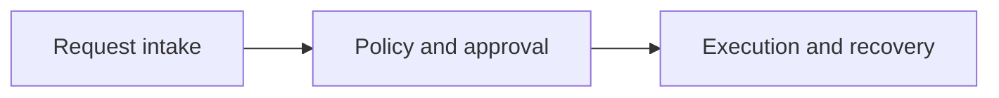

# Binoforge

An operations agent can discover powerful tools, but discovery alone does not grant permission to execute them.

A local MCP restart either returns a verified result, reconciles after a timeout or escalates when the outcome stays uncertain.

The service keeps its own checkpoint, audit trail and attempt budget. A repeat of a finished step does not apply that step again. Untrusted instruction text is denied before any side effect. The demo runs from local fixtures.

## Install

```bash
python -m pip install -e .
```

Copy the example environment if you want local paths:

```bash
cp .env.example .env
```

## Demo

```bash
bash scripts/demo.sh
```

The demo uses local fixtures. Network access is not required.

## Layout

- `identity` names actors and builds a stable operation id.
- `approval` checks the role and the approval flag.
- `operations` stores the service generation and duplicate state.
- `recovery` polls status inside a fixed bound.
- `observe` records the audit, the journal and the call budget.
- `mcp` exposes the local service tools.
- `application` builds the local run context.
- `config` loads the local, drill and quiet profiles.
- `domain` holds the policy chain and the step state machine.
- `infrastructure` writes checkpoints, snapshots and the audit log.
- `services` charges attempts, checks step order and builds the report.
- `docs/adr` records the checkpoint, input and recovery decisions.
- `docs/runbooks` covers the demo, the crash drill and a policy denial.

- `docs/architecture.md` has the Mermaid diagrams for the overview, the components and the recovery flow.
- `docs/operations.md` covers local state, retries and the failure drill.
- `docs/challenge.md` describes the open engineering decision in `starter/`.
- `docs/troubleshooting.md` lists common failures.
- `docs/security.md` lists the trust assumptions.

## Architecture



The component diagram and the recovery flow are in `docs/architecture.md`.

## Tests

```bash
pytest -q
```

The starter workspace is separate and stays incomplete until that decision is implemented:

```bash
pytest -q starter/tests
```
