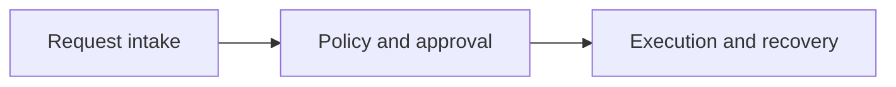

# Binoforge

An operations agent can discover powerful tools, but discovery alone does not grant permission to execute them.

This project is a local engineering exercise for Model Context Protocol (MCP).
The reference implementation installs, tests and demonstrates without a paid API.

## Install

```bash
python -m pip install -e .
```

Copy the example environment if you want local paths:

```bash
cp .env.example .env
```

## Demo

```bash
bash scripts/demo.sh
```

The demo uses local fixtures. Network access is not required.

## Layout

- `src/` holds the reference solution.
- `starter/` holds the incomplete challenge code.
- `docs/architecture.md` has the Mermaid diagrams.
- `docs/challenge.md` explains the engineering decision.
- `docs/troubleshooting.md` lists common failures.
- `docs/security.md` lists the trust assumptions.

## Architecture



The component diagram and the recovery flow are in `docs/architecture.md`.

## Tests

```bash
pytest -q
```

Starter tests are separate and are expected to fail until the challenge is solved:

```bash
pytest -q starter/tests
```
