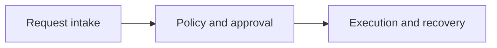
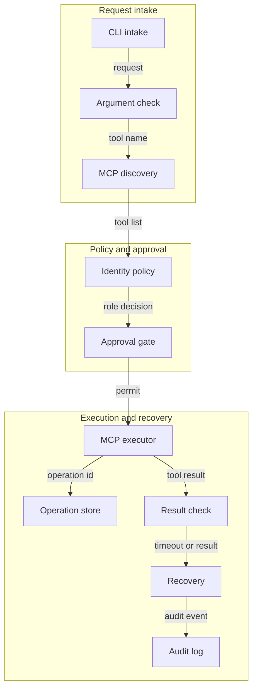
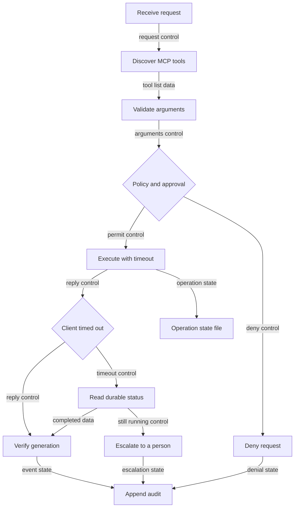

# Architecture

Scenario: An operations agent can discover a restart tool. The restart must still pass identity, policy and approval and a timed out client must reconcile durable state.

## Overview

- Request intake: in CLI request, out validated tool call.
- Policy and approval: in validated tool call, out permit or denial.
- Execution and recovery: in permitted tool call, out verified result or escalation.

## Components

- CLI intake (design): Accept the actor, tool, reason and idempotency key.
- MCP discovery (documented): List tools from a local MCP server over stdio.
- Argument check (design): Reject missing or oversized arguments.
- Identity policy (design): Allow the tool only for a matching role.
- Approval gate (design): Hold restart until an explicit approval flag is set.
- MCP executor (documented): Call the selected tool with a timeout.
- Operation store (design): Persist operation state before a delayed reply.
- Result check (design): Confirm service generation and duplicate status.
- Recovery (design): Poll status inside a bound and escalate if it stays running.
- Audit log (design): Append permit, timeout, reconcile and escalation events.

## Flows

Success: discover tools; validate arguments; approve restart; write completed operation; verify generation.

Failure and recovery: client times out; new session reads durable status; escalate when status stays running.

## Diagrams

- `docs/diagrams/level1.png` is the three-block overview.
- `docs/diagrams/level2.png` is the component architecture.
- `docs/diagrams/level3.png` is the execution and recovery flow.
- Each level also has Mermaid, SVG and a text description.

Gold marks the local design. Blue marks behavior checked against a source.
